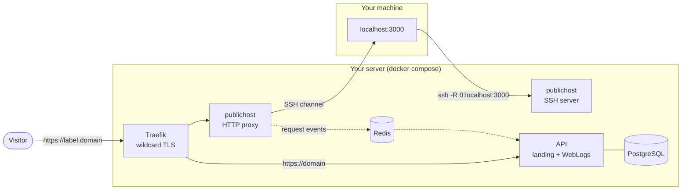

<div align="center">


# PublicHost

**Self-hosted HTTPS tunnels over plain SSH. No client and no signup. One command to deploy.**

[](https://github.com/publichost-run/publichost-backend/actions/workflows/ci.yml)
[](https://codecov.io/gh/publichost-run/publichost-backend)
[](LICENSE)
[](pyproject.toml)
[](https://github.com/astral-sh/ruff)
[](docker-compose.yml)
[](CONTRIBUTING.md)
[](https://github.com/publichost-run/publichost-backend/stargazers)

[Quick start](#-quick-start) •
[Self-host](#-self-host-in-one-command) •
[How it works](#-how-it-works) •
[Configuration](#-configuration) •
[Contributing](#-contributing)

</div>

---

Share `localhost` with the world using nothing but `ssh`:

```console
$ ssh -p 2222 -R 0:localhost:3000 tunnel.example.com

┌──────────────────────────────────────────────────────────────┐
│  PublicHost — your one-time tunnel is ready                  │
│  HTTPS URL:   https://swift-fox-123.tunnel.example.com       │
│  WebLogs:     https://tunnel.example.com/?token=…            │
│  Expires:     2026-11-02 14:00:00 UTC                        │
│  SSH host:    tunnel.example.com                             │
│                                                              │
│  Keep this SSH session open to keep the tunnel alive.        │
│  Type 'extend <minutes>' to add time (e.g. extend 30).       │
│  Press Ctrl+C or close the session to stop.                  │
└──────────────────────────────────────────────────────────────┘
```

PublicHost works like localhost.run or serveo, except **you run it on your
own server, under your own domain**.

## ✨ Features

| | |
|---|---|
| 🔑 **Zero install** | Clients need only `ssh`, which ships with macOS, Linux and Windows 10+. |
| 🔒 **Automatic HTTPS** | A Let's Encrypt wildcard certificate is issued and renewed for you. |
| 🎲 **One-time subdomains** | Readable random names (`swift-fox-123`), released when the SSH session ends. |
| 📜 **WebLogs** | A live request inspector in the browser: method, path, status, latency, headers, body. |
| ⏱️ **Lifetimes** | Tunnels expire after 2 h by default; extend them with `extend <minutes>`. |
| 🛡️ **Abuse protection** | Per-IP and global connection limits, a per-IP tunnel cap, and `Authorization`/`Cookie` redaction. |
| 🔌 **WebSockets & streaming** | WebSocket upgrades, SSE and chunked transfer pass through the tunnel. |
| 🚀 **One-command deploy** | `./deploy.sh` sets up Docker, DNS, TLS, the firewall and health checks. |

## 🚀 Quick start

On your machine (the client):

```bash
python3 -m http.server 3000                          # anything listening on localhost:3000
ssh -p 2222 -R 0:localhost:3000 tunnel.example.com   # keep this session open
```

Open the printed `https://…` URL. The WebLogs link shows every request in
real time. Inside the session, type `extend 30` to add 30 minutes, `help` to
list commands, and Ctrl+C to close the tunnel.

## 💻 Self-host in one command

**You need:**

1. A Linux server with a public IPv4 address (1 vCPU / 1 GB RAM is enough).
   Ports **80**, **443** and the client SSH port (default **2222**) must be
   free and reachable.
2. A domain on **Cloudflare** DNS. A subdomain such as `tunnel.example.com`
   works too; use one if a website already lives on the bare domain.
3. A Cloudflare API token made from the **Edit zone DNS** template, with the
   extra permission **Zone / Zone / Read**.

**Then:**

```bash
git clone https://github.com/publichost-run/publichost-backend.git
```

```bash
cd publichost-backend && ./deploy.sh
```

The script asks for the domain, an email for Let's Encrypt, the SSH port and
the token. Then it:

- installs Docker if it is missing (after asking);
- writes `.env.docker` with a generated database password, and stores the
  token in `secrets/` with mode 600;
- creates the DNS-only records `<domain>` and `*.<domain>` in Cloudflare.
  Existing records that point elsewhere are never replaced without asking;
- opens the ports in `ufw` or `firewalld` if either is active;
- builds and starts the stack, waits for the wildcard certificate and checks
  routing;
- prints the `ssh` command for your users and the server's host key
  fingerprint.

<details>
<summary><b>Non-interactive install and day-2 operations</b></summary>

```bash
CF_API_TOKEN=... ./deploy.sh --domain tunnel.example.com --email you@example.com --ssh-port 2222 -y
```

| Command | What it does |
|---|---|
| `./deploy.sh update` | `git pull`, rebuild and restart (configuration is kept) |
| `./deploy.sh status` | container status |
| `./deploy.sh logs [service]` | follow logs |
| `./deploy.sh restart` / `down` | restart / stop (data is kept) |
| `./deploy.sh --reconfigure` | change domain, email, port or token |
| `./deploy.sh --staging` | test against the Let's Encrypt staging CA |
| `./deploy.sh uninstall` | stop and **delete** all data |

Clients can use port **22** only after you move the server's own `sshd` to
another port. Make sure you can still log in before you do.

</details>

## 🧭 How it works



1. **SSH:** the client opens a remote forward. PublicHost assigns a random
   subdomain and binds a listener on loopback only.
2. **HTTPS:** Traefik terminates TLS with a single wildcard certificate.
   `<label>.<domain>` goes to the tunnel proxy, the bare `<domain>` goes to the
   API.
3. **Proxy:** routing is by `Host` header to the tunnel listener, which
   carries the request back over SSH to the client's `localhost`.
4. **WebLogs:** request metadata (with sensitive headers redacted) flows
   through Redis to the API, which streams it to the browser over a WebSocket.

More detail: [deploy/README.md](deploy/README.md) and [AGENTS.md](AGENTS.md).

## 🔧 Configuration

`deploy.sh` manages the essentials. Everything else lives in `.env.docker`; see
the comments in [.env.docker.example](.env.docker.example). Re-run
`./deploy.sh` after editing it.

| Variable | Description | Default |
|---|---|---|
| `PUBLICHOST_BASE_DOMAIN` | Tunnels are `<label>.<base_domain>` | set by `deploy.sh` |
| `PUBLICHOST_SSH_DOMAIN` | Host clients SSH into | = base domain |
| `PUBLICHOST_EXTERNAL_SSH_PORT` | Public SSH port | `2222` |
| `PUBLICHOST_ACME_EMAIL` | Let's Encrypt account email | set by `deploy.sh` |
| `PUBLICHOST_ACME_CA_SERVER` | ACME directory (production or staging) | Let's Encrypt production |
| `PUBLICHOST_DEFAULT_LIFETIME_MINUTES` | Default tunnel lifetime | `120` |
| `PUBLICHOST_MAX_EXTEND_MINUTES` | Max minutes one `extend` adds | `120` |
| `PUBLICHOST_MAX_TOTAL_LIFETIME_MINUTES` | Max total tunnel lifetime | `1440` |
| `PUBLICHOST_MAX_TUNNELS_PER_IP` | Concurrent tunnels per client IP (min 1) | `2` |
| `PUBLICHOST_MAX_CONNECTIONS_PER_IP` | Concurrent SSH connections per IP | `10` |
| `PUBLICHOST_MAX_TOTAL_CONNECTIONS` | Concurrent SSH connections in total | `500` |
| `PUBLICHOST_CORS_ORIGINS` | Extra browser origins for `/api/v1/*` | empty |
| `PUBLICHOST_TRAEFIK_IMAGE` | Traefik image | `traefik:v3.7` |

Advanced and internal variables are documented in
[`tunnel/config.py`](src/publichost/tunnel/config.py) and
[`api/config.py`](src/publichost/api/config.py).

<details>
<summary><b>Public HTTP API</b></summary>

All endpoints are served on `https://<domain>/`:

| Endpoint | Description |
|---|---|
| `GET /` | Landing page; with `?token=<token>`, the WebLogs viewer |
| `WS /channel/weblogs?token=<token>` | Live request log stream (JSON messages) |
| `GET /api/v1/stats` | Active tunnels, requests in the last 24 h, relay status |
| `GET /api/v1/cli/version` | Release metadata for an optional client CLI |

</details>

## 🔐 Security

- Clients never get a shell, exec or SFTP. The SSH session only prints a
  banner and accepts `extend`/`help`/`exit`.
- Tunnel listeners bind to `127.0.0.1` only. The proxy, API, Redis and
  PostgreSQL are not published on the host.
- Tunnel traffic payloads are not logged. WebLogs redact `Authorization`,
  `Cookie` and `Set-Cookie`.
- The WebLogs page uses a strict hash-based CSP and `no-referrer`, and renders
  request data only as text.
- The Cloudflare token is readable only by the Traefik container.

Found a vulnerability? Please report it privately, as described in
[SECURITY.md](SECURITY.md).

## 🧑‍💻 Development

```bash
uv sync                        # install dependencies (requires uv)
cp .env.example .env           # local settings (Redis disabled)
uv run python -m publichost    # SSH server :2222 + HTTP proxy :8080
```

```bash
uv run pytest -q --cov    # tests + coverage
uv run ruff check         # lint
uv run ruff format        # formatting
```

## 🤝 Contributing

Issues and pull requests are welcome. Start with
[CONTRIBUTING.md](CONTRIBUTING.md). If PublicHost is useful to you, a ⭐ helps
others find it.

## 📄 License

[MIT](LICENSE) © PublicHost contributors
